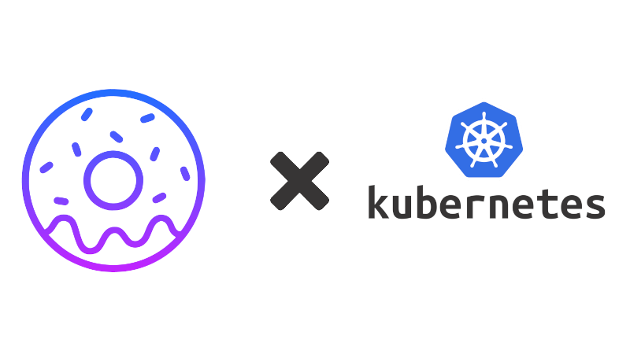

<p align="center" style="margin-top: 120px">

  <h3 align="center">homer-k8s</h3>

  <p align="center">
  
  </p>
  <p align="center">
    An Open-Source kubernetes controller to use Homer on k8s
    <br />
  </p>
</p>
<p align="center">
  <a href="https://github.com/BananaOps/homer-k8s/releases"></a>
  <a href=""></a>
  <a href=""></a>
  <a href=""></a>
  <a href=""></a>
  <a href=""></a>
  <a href=""></a>
  <a href="https://github.com/BananaOps/homer-k8s/releases"></a>
</p>


## About Homer-k8s

[Homer](https://github.com/bastienwirtz/homer) is a dead simple static HOMepage for your servER, configured from a YAML file.

homer-k8s deploys Homer on Kubernetes and builds its configuration from CRDs: every change to a `HomerServices` or `HomerPage` resource is written to the Homer config on the fly.

## Features

- [x] `HomerServices` CRD to add services to the main page
- [x] `HomerPage` CRD to create extra pages, with optional navbar link
- [x] Helm chart, Homer config managed in Helm values
- [x] EC2 discovery to generate an `ec2` page
- [x] Multi-arch images (amd64, arm64)
- [x] Custom services (smart cards)

## Getting Started 🚀

### Install with Helm

```bash
helm repo add bananaops https://bananaops.github.io/homer-k8s/
helm repo update bananaops
helm install homer bananaops/homer-k8s            # defaults
helm install homer bananaops/homer-k8s -f values.yaml  # with your values
```

The base Homer config (title, theme, links, colors...) is set in [`values.yaml`](helm/homer-k8s/values.yaml):
`homer.config` (raw YAML), `homer.structuredConfig` (merged on top) and `homer.customCss`.

### HomerServices

Adds service groups to the main page. Groups with the same name across resources are merged.

```yaml
apiVersion: homer.bananaops.io/v1alpha1
kind: HomerServices
metadata:
  name: ci
spec:
  groups:
    - name: ci
      icon: "fas fa-code-branch"
      items:
        - name: "Jenkins"
          icon: "fab fa-jenkins"
          subtitle: "CI server"
          tag: "app"
          tagstyle: "is-success"
          keywords: "build ci"   # optional, used by search
          url: "https://jenkins.example.com"
          target: "_blank"
```

### HomerPage

Creates a separate page `<pageName>.yml`, reachable at `#<pageName>`.

```yaml
apiVersion: homer.bananaops.io/v1alpha1
kind: HomerPage
metadata:
  name: infrastructure
spec:
  pageName: infrastructure
  autoLink: true                 # add a link to the navbar
  linkName: "Infrastructure"     # defaults to pageName
  linkIcon: "fas fa-server"
  groups:
    - name: "Monitoring"
      items:
        - name: "Grafana"
          url: "https://grafana.example.com"
```

More examples in [`samples/`](samples/).

## EC2 Discovery

Lists the running EC2 instances every 30s and writes a page with, for each instance, a link to its private IP and to the AWS console.

Enable it in `values.yaml`:

```yaml
env:
  - name: HOMER_EC2_ENABLED
    value: "true"
  # - name: HOMER_EC2_PAGE_NAME   # optional, defaults to "ec2"
  #   value: "servers"
serviceAccount:
  create: true
  annotations:   # EKS IRSA, or any AWS credentials available to the pod
    eks.amazonaws.com/role-arn: arn:aws:iam::<AWS_ACCOUNT>:role/<AWS_ROLE>
```

Required IAM policy:

```json
{
  "Version": "2012-10-17",
  "Statement": [{ "Effect": "Allow", "Action": "ec2:DescribeInstances", "Resource": "*" }]
}
```

## Development

Requirements: [Go](https://go.dev/) >= 1.26, [ko](https://ko.build/), [Helm](https://helm.sh/), optionally [Skaffold](https://skaffold.dev/).

```bash
make build                 # build bin/manager
make test                  # go test -race with coverage
make lint                  # golangci-lint
make generate manifests    # regenerate deepcopy and CRDs (helm/homer-k8s/crds) after changing api/
skaffold run --default-repo <registry>   # build with ko and deploy the chart to the current cluster
```

PR titles must follow [Conventional Commits](https://www.conventionalcommits.org/) (`feat:`, `fix:`, `docs:`...): releases and the changelog are generated from them by release-please.

## Contributing

Contributions are welcome, see the [`help wanted`](https://github.com/BananaOps/homer-k8s/labels/help%20wanted) issues. All contributions are subject to the [Apache 2.0 license](LICENSE).
